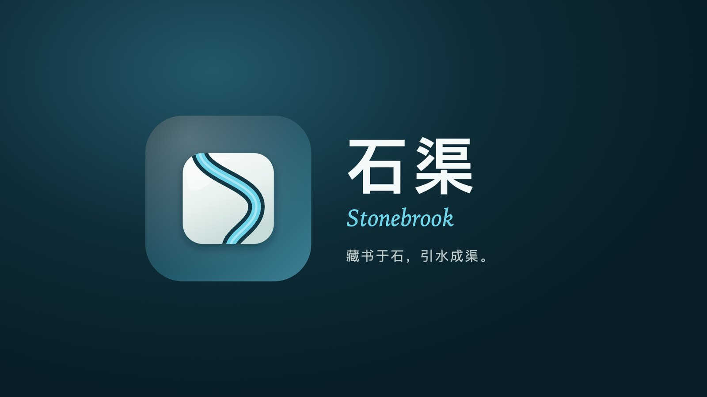
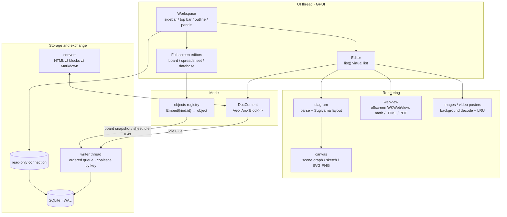

# Stonebrook

[中文](README.md)

> 藏书于石，引水成渠。
> Books kept in stone; water drawn into a channel.

A local-only block editor, written in **Rust + [GPUI](https://github.com/zed-industries/zed)** (Zed's GPU UI framework) and drawn directly with Metal.
The interface is its own: block editing, a `/` slash menu, a floating toolbar, and paste-from-web that keeps the formatting, plus four full-screen editors for boards, sketches, spreadsheets, and databases.
No account, no cloud. Everything lives in one SQLite file on your machine (only link cards reach the network, and that can be turned off in Settings).


- Version **2.2.0**. macOS 12+ only (AppKit, WKWebView, AVFoundation).
- Full feature list (Chinese): [docs/FEATURES.md](docs/FEATURES.md)
- Website (Chinese): <https://davidzhanghui.github.io/stone-book/>

<p align="center">
  <a href="docs/stonebrook-promo-v2.2.mp4"></a><br>
  <a href="docs/stonebrook-promo-v2.2.mp4">▶ Watch the promo</a> · <sub>72 seconds, in Chinese: blocks · paste from the web · diagrams and math · boards · sketches · spreadsheets · databases · local-only data</sub><br>
  <sub>Music: “Awakening Dew” by <a href="https://soundcloud.com/keysofmoon">Keys of Moon</a> (<a href="https://creativecommons.org/licenses/by/4.0/">CC BY 4.0</a>)</sub>
</p>

## What it does

| Area | What you get |
|---|---|
| Documents | Six heading levels, nested lists and to-dos, quotes, callouts, code blocks (highlighting for 19 languages), tables, columns, image crop and scale; Markdown shortcuts; comments; synced blocks; templates |
| Paste and export | Paste from the web and keep the formatting; copy writes both HTML and Markdown; import Markdown; export Markdown / HTML / PDF |
| Diagrams and math | A built-in Mermaid-style renderer (flowchart, sequence, class, state, ER, Gantt, pie, mind map, timeline); KaTeX, block and inline |
| Boards | Shapes, connectors, sticky notes, frames, swimlanes, freehand, mind maps, about 23,000 assets, 60 templates; Mermaid / PlantUML converted into editable shapes |
| Sketches | Excalidraw-compatible hand-drawn whiteboard: bound arrows, text in shapes, frames; opens and saves `.excalidraw` / Obsidian files and pastes to and from excalidraw.com |
| Spreadsheets | IronCalc formula engine (497 functions), conditional formatting, data validation, dropdowns, filter and sort, freeze panes, multiple sheets, xlsx / CSV |
| Databases | 21 field types, formulas and relation lookups; table / kanban / gallery / Gantt / calendar / form; virtual scrolling in both directions, tested at 100,000 rows |
| Rich blocks | Link cards, video, file attachments (preview for code / PDF / Office / audio / archives), HTML blocks, countdowns, buttons, timelines |
| Finding your way | Document tree and trash, full-text search (FTS5), command palette (pinyin), outline, presentation mode, focus mode, writing heatmap |

## Quick start

Requirements: macOS, Rust 1.85+ (`rustup update`), and the Xcode command-line tools (`xcode-select --install`).
No Metal toolchain is required (GPUI's `runtime_shaders` feature compiles shaders at runtime).

```bash
cargo run --release            # run directly (includes dev features)
scripts/build.sh               # format / clippy / tests → release → dist/石渠.app + DMG
scripts/build.sh --fast --run  # package only, then launch (quits a copy that is already running)
```

`scripts/build.sh` flags:

| Flag | Effect |
|---|---|
| `--fast` | Skip `cargo fmt --check`, clippy, and unit tests |
| `--dev` | Keep dev features in the release package (scripted tests, benchmark menu) |
| `--no-dmg` | Build `dist/石渠.app` only |
| `--run` | Launch after packaging |

The build is ad-hoc signed. The first launch may need approval under System Settings → Privacy & Security.

## Data and durability

- **Where it lives**: `~/Stonebrook/` (override with `STONEBROOK_DATA_DIR`): `stonebrook.db` plus an `assets/` directory. Copy the folder and you have a backup.
- **Full backup / restore**: 文件 → 导出完整备份… (also in the `···` menu and the command palette) zips a `stonebrook.db` snapshot together with `assets/`. 从备份恢复… checks the archive and stages it; it **takes effect after restart**. The previous data is moved to `recovery/pre-restore-<time>/` and is not deleted. Image paths inside documents, boards, and databases are rewritten when you move to another machine (different username or directory). Images inside spreadsheet cells still need the same path to show up.
- **Writes**: every write goes through one background thread and runs in submit order. Document and embed saves are coalesced by key, so only the latest snapshot is written. The UI thread uses a separate read-only connection (WAL: readers and the writer do not block each other). Quit and window close wait for the queue to drain.
- **Failures stay visible**: a failed write shows the reason at the top of the window. Data is not dropped silently.
- **Corruption**: if a document's JSON cannot be parsed, the original is copied to `recovery/`, a short explanation document is opened, and empty content is never written back over it.
- **Upgrades**: the schema version is `PRAGMA user_version`. On startup the migrations in `store::MIGRATIONS` run in order.
- **Garbage collection**: on startup, a background pass deletes embed objects that have not been referenced for 7 days by any document (including trash), user template, or synced block.

## Architecture



Design notes:

- **Text slots**: every editable region is a slot (one per ordinary block, one per table cell, one per column). The cursor is `(block, slot, UTF-8 offset)`.
- **Rendering**: selection, IME composition, find highlights, and syntax highlighting (cached by content) all fold into `TextRun`. The virtual list means paint cost tracks what is on screen. The caret blinks only while the window is focused.
- **Undo**: a document is `Vec<Arc<Block>>`, so a snapshot copies pointers. The undo stack is capped and drops from the front.
- **Embeds**: boards, spreadsheets, and databases are referenced by an `Embed{kind,id}` block and stored in their own table. A board is an immutable snapshot handed to the writer thread. A spreadsheet is mutated in place and encoded into the queue after you stop editing. A database is written row by row, per field, record, and view.
- **Synced blocks**: consecutive blocks that share a `sync` id form a group. Saving writes the sync table; opening a document replaces the group with the latest content.
- **Document format**: block JSON carries a version. A block an older build does not understand becomes an "unsupported block" and keeps its original data.

## Source map

| Path | What it is |
|---|---|
| `src/main.rs` | Startup, shortcuts and menus, `flush_all` before exit |
| `src/store.rs` | SQLite: writer thread and coalesce queue, migrations, full-text search, comments / templates / synced blocks / key-value |
| `src/model.rs` | Blocks and rich text, JSON serialization, version compatibility |
| `src/objects.rs` | Embed registry (`ObjKind`), save policy, garbage collection |
| `src/editor/` | Document editor: `ops` edits, `nav` cursor and hit testing, `clip` clipboard, `input` IME, `render` block painting; `table_render` / `menus_render` / `toolbar_render`; `attach` / `media` / `fileview` for attachments and video |
| `src/workspace.rs`, `src/workspace/` | Main window; settings, command palette, presentation, PDF export, writing stats |
| `src/convert.rs` | HTML / Markdown import and export (paste-from-web) |
| `src/canvas/`, `src/diagram/` | 2D scene graph and painting; Mermaid / PlantUML parsing and layered layout |
| `src/board/` | Board, flowchart, and mind-map model plus the full-screen editor |
| `src/sketch/` | Excalidraw-compatible sketch: the official `.excalidraw` model, hand-drawn renderer, import/export, and the full-screen editor |
| `src/sheet/` | Spreadsheet UI (`commands`, `mouse`, `paint`; calculation is IronCalc) |
| `src/base/` | Database: `model` data and undo, `db` row storage, `formula` / `calc`, `editor` / `chrome` |
| `src/highlight.rs` | Syntax highlighting shared by code blocks, text boxes, and attachment preview |
| `src/webview.rs`, `src/math.rs`, `src/linkcard.rs`, `src/media.rs` | Offscreen WebView, KaTeX, link-card fetch (honors the system proxy), video |
| `src/autotest.rs`, `src/*/script.rs` | Scripted end-to-end tests (`dev` feature) |
| `vendor/` | Patched GPUI 0.2.2 and IronCalc 0.9.1. See [docs/VENDOR_PATCHES.md](docs/VENDOR_PATCHES.md) (Chinese) |

About 86,000 lines of Rust. Main dependencies: `gpui`, `ironcalc`, `rusqlite` (bundled SQLite with FTS5), `roughr` (sketch style), `resvg`, `pulldown-cmark`, `scraper` + `ureq` (link cards), `symphonia` (audio), `objc2-*` (system APIs). The release binary is about 37MB.

## Development

```bash
cargo test                          # unit tests
cargo clippy --all-targets          # lints
cargo fmt                           # format (rustfmt.toml: max_width = 160)
cargo build --no-default-features   # build without dev features (this is what the release package uses)
```

The Cargo feature `dev` is on by default. It includes scripted tests, the benchmark data generator, and the benchmark menu. Release packages are built with `--no-default-features`, so that code is not in the app.

**End-to-end tests**: launch with `STONEBROOK_SCRIPT=path/to/script`. Events go through GPUI's own pipeline — real shortcut matching and the real input path:

```text
key cmd-n                  # key press
type 你好 **粗体** 世界      # type one character at a time (Markdown shortcuts fire)
ime nihao / commit 你好     # IME composition / commit
click 400 300 2            # double-click
html ./sample.html         # put HTML on the clipboard (as if copied from a browser)
sheet set A1 100           # drive a spreadsheet / board / database
dump / shot 名称 / wait 毫秒 / quit
```

Use `STONEBROOK_DATA_DIR` to point at a throwaway data directory. `STONEBROOK_FORCE_DRAW=1` keeps painting a window even when it is covered. `STONEBROOK_SHOT_DIR` sets the screenshot directory. The full command list is in `src/autotest.rs`.

## Shortcuts

| Action | Shortcut |
|---|---|
| New document / subdocument | `⌘N` / `⇧⌘N` |
| Quick open (full-text search) / command palette / settings | `⌘P` / `⇧⌘P` / `⌘,` |
| Find in document | `⌘F`, then `⌘G` / `⇧⌘G` for next / previous |
| Bold / italic / underline / strikethrough / inline code / link | `⌘B` / `⌘I` / `⌘U` / `⇧⌘X` / `⌘E` / `⌘K` |
| Body / heading 1–4 | `⌥⌘0` / `⌥⌘1`–`⌥⌘4` |
| Numbered / bulleted / to-do / quote / code block | `⇧⌘7` / `⇧⌘8` / `⇧⌘9` / `⇧⌘.` / `⌥⌘C` |
| Toggle to-do / duplicate block / move block | `⌘↵` / `⌘D` / `⌃⌘↑` `⌃⌘↓` |
| Paste as plain text | `⇧⌘V` |
| Sidebar / outline / focus / light-dark / performance panel | `⌘\` / `⇧⌘O` / `⇧⌘F` / `⇧⌘D` / `⌥⌘P` |
| Import / export Markdown | `⌘O` / `⇧⌘E` |
| Presentation mode | `F5` |

Board and spreadsheet shortcuts are in [docs/FEATURES.md](docs/FEATURES.md#15-快捷键速查) (Chinese).

## Known limits

- macOS only. No cloud sync and no multiplayer — local-only is the design.
- Some interactions have only been checked by the scripted tests and still need a real machine: mouse feel, dragging the window from the top bar, system file dialogs, video playback, interactive HTML blocks, and Chinese IME behavior inside boards and tables.
- Queries shorter than 3 characters skip the full-text index (a trigram tokenizer limit) and get slower when you have many documents.

## License

[MIT](LICENSE)
