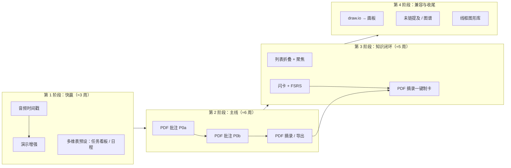

# 文档嵌入 / 增强模块路线图（评审修订版）

> 取代旧稿 `embed-modules.md`（已删除）。本稿按 2026-11-05 的代码核对结果重写：旧稿 10 个模块里有 1 个已落地、2 个与多维表格重复、1 个形态选错，按「能落地 + 不重复造轮子」重新排序。
> Excalidraw 草图仍见 [`sketch-module.md`](./sketch-module.md)，不在本稿范围。

**总约束（沿用）**：纯本地、无账号、无多人协作；不改坏画板 / 电子表格 / 多维表格；不熟悉的能力先找开源对照。估期按「熟悉本仓 1 人全职」粗算。

## 落地状态（2026-11-05，分支 `feat/embed-roadmap`）

七个模块落地，PDF 批注与闪卡按 2026-11-05 决定整体移除（代码、依赖一并删掉）；`scripts/check.sh` 通过；演示、折叠、draw.io、图谱、线框都用 `STONEBROOK_SCRIPT` 真窗口截图核对过。

| 模块 | 状态 | 与本文方案的出入 |
|---|---|---|
| 音频时间戳 | ✅ 已落地 | 链接用资源文件名定位音频（块 id 不落盘）；单击即跳转，不需要 ⌘ |
| 演示模式增强 | ✅ 已落地 | 演讲者视图做成同一窗口内按 `S` 切换，没开第二个窗口；画笔、「演示 PDF」未做（本文已列为后置） |
| 多维表预设 | ✅ 已落地 | — |
| PDF 批注阅读 | ❌ 已移除 | 实现过一版（PDFKit），后决定不要，代码与 `objc2-pdf-kit` 依赖已删除 |
| 列表折叠 + 聚焦 | ✅ 已落地 | 随机测试加了折叠 / 聚焦操作和「光标不能停在隐藏块」的不变量，600 个种子通过 |
| 闪卡 + 挖空 + FSRS | ❌ 已移除 | 实现过一版（rs-fsrs），后决定不要，代码与 `rs-fsrs` 依赖已删除 |
| draw.io 导入 | ✅ 已落地 | 入口是斜杠「导入 draw.io」和拖入文件，画板内「更多」菜单里没加 |
| 未链提及 + 图谱 | ✅ 已落地 | — |
| 线框图形库 | ✅ 已落地 | 模板只保留登录页、列表页（详情页模板已删） |

已拍板（2026-11-05）：演讲者备注新增 `BlockKind::Notes`；折叠状态不进同步块 / 模板；PDF 批注与闪卡彻底删除；线框模板删除「详情页」。下文第 4、6 节的方案仅作历史记录。

---

## 一、评审结论

### 1. 与代码现状冲突的地方

| 旧稿条目 | 代码现状（已核对） | 结论 |
|---|---|---|
| P2 反向链接 v1：「解析 `[[标题]]`、侧栏反向链接」 | **已落地**：`@` 插入 `stonebrook://doc/<id>` 链接（`editor/links.rs`），`Store::backlinks`（`store.rs:300`）+ 右侧大纲下方「反向链接」，有单测 | 删去 v1 与「双链语法拍板」；只剩「未链提及」「图谱」 |
| P1 轻量看板（新 `ObjKind::Kanban`） | 多维表格已有看板视图（斜杠「多维表格 → 看板」直接建），画板模板里也有「看板」 | **不新建 kind**。两套看板会让用户困惑、数据还互不相通 |
| P1 日历 / 日程块（新 `ObjKind::Calendar`） | 多维表格已有日历视图（按日期字段排月历，可拖动改日期） | **不新建 kind**，同上 |
| P1 大纲笔记（新 `ObjKind::Outline`） | 正文列表已支持 `Tab` / `⇧Tab` 缩进；画板有思维导图；`···` 能「以思维导图查看文档」。**缺的只是列表折叠和聚焦** | 改成**编辑器增强**，不做独立对象（独立对象里的内容搜不到、链不到、导不出） |
| P0 PDF 默认路线 A「WKWebView + pdf.js」 | `webview.rs` 只有 `evaluateJavaScript`，**没有 JS → Rust 消息通道**（无 `WKScriptMessageHandler`）；但已有原生 `QLPreviewView` 覆盖层的成熟写法（`LiveSrc::QuickLook`） | 改为默认 **PDFKit `PDFView` 原生覆盖层**（理由见第三节） |
| P2 draw.io v1「先栅格化 / SVG 放入」 | 原生渲染 draw.io 本身就要解析 mxGraph 并逐形状绘制，难度≈直接映射成画板；离线跑官方 viewer JS 要打包数 MB 脚本 | 跳过「保真图片」阶段，**直接映射到 `BoardDoc` 可编辑子集** |
| P2 演示模式增强 | `workspace/panels.rs::slide_block` 只渲染纯文本 / 标题 / 列表 / 代码 / 图片 / 公式 / 文本绘图；**表格、分栏、行内样式、嵌入对象（画板 / 表格 / 多维表）在演示里都不显示** | 先补渲染缺口，再谈备注和画笔 |
| P3 低保真线框控件库 | 画板已有 57 个模板 + 18 套素材库；草图模块尚未开工 | 不依赖草图，**直接做成画板「线框」图形库分组 + 模板** |

### 2. 落地性打分

| 模块 | 价值 | 成本 | 风险 | 结论 |
|---|---|---|---|---|
| 音频时间戳笔记 | 中 | 低（≈1 周） | 低：播放器、链接机制都已有 | ✅ **立即做** |
| 演示模式增强 | 中高 | 低中（≈2 周） | 低：纯 GPUI 渲染 | ✅ **立即做** |
| 列表折叠 + 聚焦（原「大纲笔记」） | 中高 | 中（≈2–3 周） | 中：动编辑器核心（光标 / 选区 / 撤销） | ✅ 做，需小心 |
| PDF 批注阅读 | 高 | 高（≈5–7 周） | 中：原生视图覆盖层 + 坐标锚点 | ✅ 做，主线项目 |
| 闪卡复习 | 中 | 中（≈2–3 周） | 低：有现成 FSRS crate | ✅ 做，排在 PDF 之后 |
| draw.io 导入 | 中 | 中（≈2–3 周） | 中：形状 / 样式长尾 | ✅ 做子集 |
| 未链提及 + 图谱 | 中 | 中（≈2–3 周） | 低 | 🟡 可做，优先级低 |
| 画板线框库 | 低中 | 低（≈1 周） | 低：许可 | 🟡 有空就做 |
| 轻量看板 / 日历块 | — | — | 与多维表重复 | ❌ 改为多维表「预设」（≈2–3 天） |

---

## 二、执行顺序

快赢放前面：两项都只碰已有代码、一周内能看到效果，也顺带把「新 BlockKind / 新链接协议 / FEATURES 更新」这套流程跑通，给 PDF 铺路。草图（`sketch-module.md`）可与第 2 阶段两路并行。

---

## 三、各模块落地方案

### 1. 音频时间戳笔记（≈1 周）✅

**现状**：`editor/audio.rs` 已有 AVPlayer 播放、symphonia 波形、ogg 转码；链接已有 `stonebrook://doc/<id>` 协议与 `⌘` + 点击跳转。

**方案**
- 播放条加「插入时间戳」按钮（快捷键可选 `⌥⌘T`，注册进 `shortcuts.rs`）：在**最近一次编辑光标处**插入行内链接 `▶ 12:34`，URL 为 `stonebrook://seek/<音频块 id>?t=754`。
- 点击时间戳：滚动到对应音频块 → seek → 播放。复用 `links.rs` 的点击分发，新增一个前缀分支即可。
- 音频块被删 / 不在本文档：点击提示「音频已删除」，不报错。
- 导出：Markdown / HTML 降级为纯文本 `▶ 12:34`。

**不做**：元数据里存备注（时间戳旁边直接写正文就是备注）、转写。

**验收**：边听边打三个点，点回对应位置；撤销能撤掉插入；复制粘贴到另一篇后点击给出合理提示；音频预览无回归。脚本测试覆盖「插入 → 点击 → 播放位置」。

### 2. 演示模式增强（≈2 周）✅

**现状**：`panels.rs` `build_slides` 按二级及以上标题分页，`slide_block` 逐类渲染，大量块类型缺失。

**分步**
1. **补渲染缺口（先做，价值最大）**：行内样式（粗斜体 / 颜色 / 链接 / 行内公式）、表格、分栏、高亮块 emoji、嵌入对象用现有 Embed 预览图（画板 / 电子表格 / 多维表缩略）、视频 / 文件显示卡片。能复用编辑器渲染函数的尽量复用，不另写一套。
2. **演讲者备注**：约定「标题下第一个以 `备注：` / `Notes:` 开头的引用块」为备注，演示时隐藏。不新增块类型，导出无副作用。
3. **演讲者视图（可选）**：GPUI 开第二窗口显示当前页 + 下一页 + 备注 + 计时；单屏时按 `S` 切换。
4. **激光笔 / 计时**：按 `L` 鼠标变红点；右下角可隐藏的计时器。
5. 画笔、导出「演示 PDF」后置（导出要和现有文档 PDF 区分，收益不大）。

**参考**：Marp / Slidev 的备注约定与演讲者视图布局。

**验收**：欢迎文档里含表格、画板、公式的章节在演示中都能看到；F5 / 翻页 / Esc 行为不变；FEATURES 第 14 节更新。

### 3. 多维表格预设：任务看板 / 日程（≈2–3 天，替代旧稿 P1 看板 / 日历）

- 斜杠菜单新增「任务看板」：建多维表，预置字段「标题 / 状态（单选：待办·进行中·完成）/ 截止日期 / 负责人」，默认看板视图并附带日历视图。
- 斜杠菜单新增「日程」：预置「事项 / 日期 / 备注」，默认日历视图。
- 拼音搜索词：`kanban renwu kb`、`richeng rili calendar`。
- 文案直接说明「这是多维表格，可切换其他视图」，不另造概念。

**不做**：独立 `ObjKind::Kanban` / `Calendar`、Calendar.app 同步。`.ics` 导出如有需要作为多维表日历视图的导出项另立。

### 4. PDF 批注阅读器（≈5–7 周）✅ 主线

**宿主选型：默认 PDFKit 原生视图**（推翻旧稿的 pdf.js 默认）

| | PDFKit `PDFView` | WKWebView + pdf.js |
|---|---|---|
| 与现有代码 | 照搬 `LiveSrc::QuickLook` 的原生 NSView 覆盖层写法 | 要新建 `WKScriptMessageHandler` 双向通道 |
| 文本选择 / 搜索 / 目录 / 缩略图 | 系统自带（`PDFSelection`、`findString`、`outlineRoot`、`PDFThumbnailView`） | pdf.js viewer 自带，但要改 viewer 或自写 UI |
| 高亮绘制 | `PDFAnnotation`（highlight / underline / strikeOut / text） | 自己在 text layer 上画 |
| 写回 PDF | `PDFDocument.write(to:)` 一行 | 需 `pdf-lib` 等再加一层 |
| 包体 | 0 | +数 MB |
| 依赖 | 加 `objc2-pdf-kit` crate（与现有 objc2 0.6 同族） | 无 |

两者都是 NSView 覆盖在 GPUI 之上，弹层遮挡问题相同，PDFKit 没有劣势。pdf.js 保留为后备（例如以后需要跨平台）。

**数据模型**
- `ObjKind::PdfDoc`（`"pdfdoc"`）：PDF 文件拷进 `assets/`；对象行存 `{ asset, last_page, annots: [...] }`。
- 批注权威数据在 SQLite，**不默认写回 PDF**；PDFKit 只负责显示（加载时把 annots 转成临时 `PDFAnnotation`）。
- 锚点：`page` + `quads`（页内 PDF 坐标）+ 摘录文本；`quads` 用于绘制，文本用于失配时兜底重定位。

**接入点**（与 `sketch-module.md` 同一张清单）：`objects.rs`（注意 `default_data` 的 `_ =>` 兜底）、`editor/ops.rs` 斜杠、`editor/blocks.rs` Embed 预览（首页缩略图用 `PDFPage.thumbnail` 生成并缓存）、`model.rs` 标签、`workspace.rs::open_embed`、`autotest.rs`、`backup.rs`（确认 assets 被打包）、`main.rs` `mod pdfdoc;`。

**目录**：`src/pdfdoc/{mod,model,view,host,io}.rs`，`host.rs` 放全部 objc 代码。

**分期**
- **P0a 能读能划（≈2 周）**：斜杠「PDF 阅读」选文件；全屏 `PDFView` 翻页 / 缩放 / `⌘F`；选中文字后浮出「高亮（4 色）/ 下划线 / 删除」；右侧批注列表点击定位；记住上次页码。
- **P0b 精读（≈2 周）**：页内便签（`PDFAnnotation` text）；批注筛选 / 搜索；目录侧栏；缩略图条；「摘录到正文」——插入引用块 + `stonebrook://pdf/<obj>?page=12&annot=<id>` 链接，点击跳回原位。
- **P0c 衔接（≈1 周）**：附件 PDF 工具栏「转为可批注 PDF」；批注导出 Markdown；暗色模式反色阅读（`PDFView` 背景 + 页面滤镜）。
- **后置**：写回 PDF（显式「导出带批注的 PDF」）、墨迹、OCR（可用系统 Vision 框架，另立项）。

**非目标**：编辑页面、表单、签名、文献管理。

**验收**：中英文文字层 PDF 手测；200 页以上 PDF 打开 < 1 秒；备份恢复后批注完整；附件 Quick Look 预览与「导出为 PDF」无回归；model / 锚点编解码有单测。

### 5. 列表折叠 + 聚焦（≈2–3 周，替代旧稿「大纲笔记」）✅

**现状**：列表靠 `indent` 表达层级，无折叠，无聚焦。

**方案**
- **折叠**：块上加 `collapsed: bool`（`serde(default)`，旧数据兼容）。有子级（后续 indent 更深的连续块）的列表项 / 标题左侧显示三角；`⌘.` 切换（与思维导图一致）。折叠只影响渲染与光标跳过，不改数据。
- **聚焦（zoom in）**：点项目符号进入「只看这一项及其子级」，面包屑显示路径，`Esc` 或点面包屑返回。这是 Workflowy 的核心体验，实现上是渲染层过滤。
- **导出**：Markdown 本来就是缩进列表，无需新增。
- **已有能力联动**：FEATURES 里把「以思维导图查看文档」写在一起，形成「列表 ⇄ 导图」的大纲工作流。

**风险**：光标在折叠区域内时的行为、选区跨折叠、撤销粒度、查找命中折叠内容时自动展开。动手前先读 Logseq 的 block collapse 处理与本仓 `editor/nav.rs`。

**验收**：一份 3 层会议纪要可折叠 / 聚焦 / 导出；fuzz 测试（`editor/fuzz_tests.rs`）加折叠状态随机操作。

### 6. 闪卡复习（≈2–3 周）✅

**形态**：新 `BlockKind::Flashcard { front, back, card: FsrsState }`，与倒计时 / 时间轴同属文档小组件；不做 `ObjKind`（卡片要能被全文搜索、跟着文档走）。

**方案**
- v1：斜杠「闪卡」；块内正面 / 背面两个富文本区，点击翻面。
- v2：`⌘P` / 命令面板「开始复习」打开全局复习面板：扫描所有文档的到期卡片（SQLite 侧加一张 `cards(doc_id, block_id, due)` 索引表，保存文档时维护），按 FSRS 排程；评分 1–4 键。
- v3：PDF 摘录 / 选中文字「制成闪卡」。

**参考**：`rs-fsrs`（open-spaced-repetition 官方 Rust 实现，MIT）——直接依赖，不自写算法；交互参考 Anki。

**验收**：建 20 张卡按计划复习；删除文档后卡片从队列消失；备份恢复后复习状态完整。

### 7. draw.io 导入（≈2–3 周）✅ 子集

- 解析 `.drawio` / `.xml`：`mxfile > diagram`，内容可能是 `deflate-raw + base64 + URL 编码` 压缩形式，需先解压；多页 diagram 每页一个画板。
- 映射到 `BoardDoc`：矩形 / 圆角矩形 / 椭圆 / 菱形 / 文本 / 泳道（swimlane）/ 便签 → 画板对应图形；`edge` → 连线（保留 `points` 拐点、箭头、虚线）；`fillColor` / `strokeColor` / `fontColor` / `fontSize` 映射。未识别形状一律降级为带文字的矩形，并在导入结束提示「N 个形状已简化」。
- 入口：画板「更多 → 导入 draw.io」、文档拖入 `.drawio` 文件时询问「作为画板导入 / 作为附件」。
- `.drawio.svg` / `.drawio.png` 本来就是图片，走现有图片插入，不特殊处理。
- 参考 `src/diagram/` 里 Mermaid / PlantUML → 画板的转换代码组织方式；格式参考 jgraph/drawio 的 `mxGraphModel` 文档。

**不做**：导出回 `.drawio`、模板库在线拉取。

**验收**：用 draw.io 官方示例里的流程图、泳道图、架构图各一个导入，结构正确、可编辑；fixture 进 `cargo test`。

### 8. 未链提及 + 图谱（≈2–3 周）🟡

- **未链提及**：在反向链接下方加「未链接的提及」——用已有 FTS5 索引按标题全文匹配；每条「一键转为链接」。短标题（< 2 字）跳过，避免噪声。
- **图谱**：全屏视图，节点 = 文档、边 = `stonebrook://doc/` 链接；力导向布局可参考画板已有布局代码或 `fdg` 类 crate；默认显示当前文档 2 跳邻居。
- 先做未链提及（小、实用），图谱看用户反馈再决定。

### 9. 画板线框图形库（≈1 周）🟡

- 在画板图形库（`M`）加「线框」分组：按钮、输入框、下拉、复选、Tab、导航栏、卡片、手机 / 浏览器外框——全部用普通图形组合，不引第三方素材，规避许可问题。
- 补 2–3 个模板（登录页、列表页、详情页）。
- 草图模块上线后再考虑移植一份到草图。

---

## 四、明确不做

- 独立的轻量看板 / 日历嵌入对象（用多维表预设代替）
- 独立大纲对象（用列表折叠 + 聚焦代替）
- 完整 draw.io 编辑器、Figma 级原型、云同步、多人协作
- 把多维表 / 画板推倒重来统一成一个画布

## 五、横切检查清单（每个模块交付前）

- [ ] 新 `ObjKind` / `BlockKind`：编解码、复制、回收（`objects.rs` 自动回收逻辑）、备份恢复、Markdown / HTML 降级导出
- [ ] 斜杠文案 + 拼音搜索词；中英 i18n
- [ ] `STONEBROOK_SCRIPT` 脚本测试能覆盖的都加上，其余写手测清单
- [ ] 更新 `docs/FEATURES.md`，本文对应节标「已落地」

## 六、拍板记录

1. PDF 宿主：PDFKit ✅
2. 演讲者备注：新增隐藏块 `BlockKind::Notes` ✅
3. 闪卡支持挖空（`{{c1::…}}`，每个序号一张卡）✅
4. 折叠状态不参与同步块 / 模板 ✅
5. PDF 批注、闪卡彻底删除；线框模板去掉「详情页」 ✅
